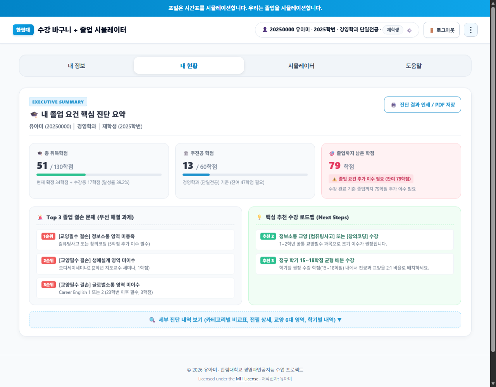
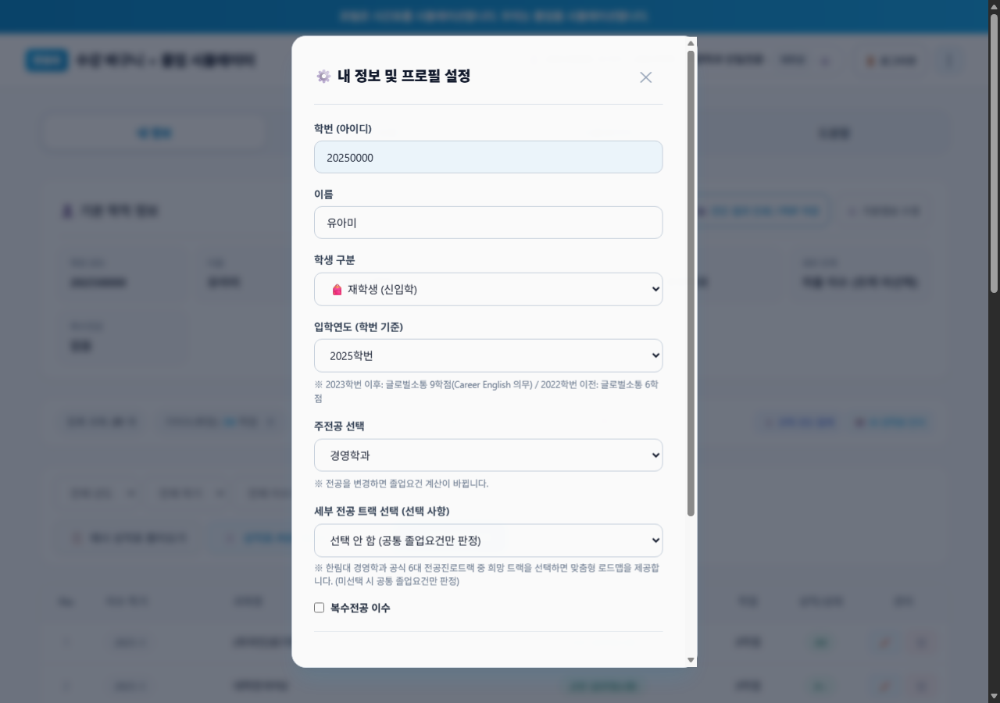
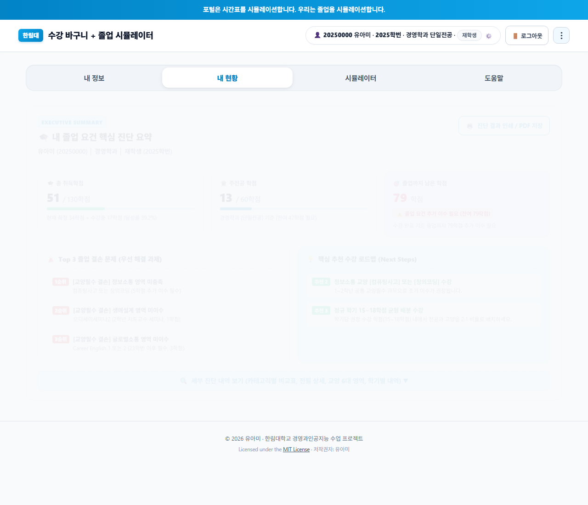
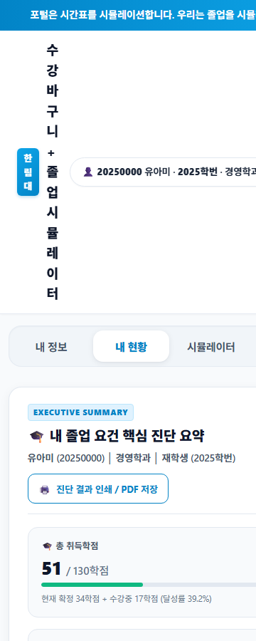

# 🎓 한림 수강 바구니 + 졸업 시뮬레이터 (hallym-grad-simulator)

> **"포털은 시간표를 시뮬레이션합니다. 우리는 졸업을 시뮬레이션합니다."**  
> 한림대학교 학생들을 위한 실시간 졸업 요건 시뮬레이터 웹 애플리케이션입니다.  
> 다음 학기 수강할 과목을 장바구니에 담는 즉시 미래의 졸업 요건 충족 여부와 잔여 학점, 중복 과목 경고, 그리고 **희망 진로 트랙 로드맵**을 실시간으로 진단합니다.

---

## 🌐 실시간 모바일 및 웹 접속 (GitHub Pages)

별도의 앱이나 프로그램 설치 없이 스마트폰(iOS/Android) 및 PC 웹 브라우저에서 바로 이용할 수 있습니다.

| 접속 용도 | URL 주소 | 접속 방법 및 특징 |
| :--- | :--- | :--- |
| **일반 모바일/웹 접속** | [https://grantfenix.github.io/hallym-grad-simulator/](https://grantfenix.github.io/hallym-grad-simulator/) | 일반 학생 접속용 (데모 로그인 버튼 완전 은닉) |
| **관리자 데모 모드** | [https://grantfenix.github.io/hallym-grad-simulator/?demo=true](https://grantfenix.github.io/hallym-grad-simulator/?demo=true) | 관리자 비밀번호(`demo2026!`) 인증 후 즉시 체험 가능 |
| **최신 캐시 우회 접속** | [https://grantfenix.github.io/hallym-grad-simulator/?v=20261125](https://grantfenix.github.io/hallym-grad-simulator/?v=20261125) | 모바일 브라우저의 구버전 캐시를 무시하고 최신 화면 강제 로드 |

> **💡 데모 계정 시크릿 진입법**:  
> 일반 URL 접속 상태에서도 로그인 창 상단의 **[한림대학교 학생 전용]** 안심 로그인 배지를 **1.5초 내에 3회 연속 클릭(터치)**하면 데모 로그인 버튼이 부드럽게 토글됩니다.

---

## 📌 주요 핵심 기능 (Top 10)

1. **한림대학교 경영학과 공식 6대 전공 진로 트랙 로드맵 (신규)**
   - 한림대학교 입학처 공식 발간 [경영학과.pdf](https://admission.hallym.ac.kr/sites/hallym/files/%EA%B2%BD%EC%98%81%ED%95%99%EA%B3%BC.pdf)(p.6~7) 기반의 **6대 공식 진로 트랙**을 완벽 반영:
     1. **회계·세무 트랙**: CPA/CTA 전문자격증 및 기업 재경·세무 전문가 양성
     2. **의료경영 트랙**: 의료기관, 건강보험공단, 심평원, 제약바이오 헬스케어 리더 양성
     3. **글로벌혁신전략 트랙**: 대기업 기획/전략/해외영업 및 경영컨설팅 전문가 양성
     4. **비즈니스인텔리전스 트랙**: 비즈니스 데이터 분석, BI, 전략 수립 및 데이터 과학자 양성
     5. **관광경영 트랙**: 호텔, 항공사, 리조트, 한국관광공사, MICE 국제회의 인재 양성
     6. **마케팅기획 트랙**: 기업 마케팅 기획, 상품기획(MD), 시장조사분석가 양성
   - **선택 방법**: 상단 프로필/설정 모달에서 희망하는 트랙을 언제든지 자유롭게 선택·변경 가능.
   - **자율 권장 로드맵**: 공식 졸업요건이 아닌 "진로 권장 로드맵"으로 분리되어, 트랙을 선택하지 않거나 권장 과목을 다 듣지 않아도 공식 전공 학점(60학점, 복수전공 33학점)만 채우면 정상 졸업 가능.

2. **독립된 졸업시험 면제 판정표 상시 제공 (학과 공식 내규 분리)**
   - 학과 공식 내규(`졸업기준_경영학과.txt` 라인 56-67)에 따른 **졸업시험 9개 분야 중 4개 분야 B0 이상 취득 면제 판정표**를 트랙 선택과 무관하게 상시 독립 카드로 표시.
   - **9개 분야 전수 추적**: 회계학, 조직 및 인사관리, 재무관리, 마케팅, 경영과학 및 생산관리, MIS, 경영전략, 의료경영, 관광경영.
   - **캡스톤디자인 보너스**: 캡스톤디자인(210112) B0 이상 취득 시 최대 1개 분야 추가 면제 보너스 자동 계산.

3. **2단계 졸업 요건 진단 분석표 (Executive Summary & Collapsible Details)**
   - **1화면 핵심 요약 카드**: 총 취득 학점, 전공 학점, 잔여 학점 3대 KPI와 함께 부족 요건 Top 3, 맞춤 추천 과목을 한눈에 파악.
   - **접이식 세부 진단 내역**: 카테고리별 학점 비교, 공통 교양 6대 영역 상세 진행률, 학기별 이수 내역을 원클릭으로 열람.
   - **A4 규격 인쇄 및 PDF 저장**: 🖨️ 원클릭으로 학생 상담용 공식 졸업 진단 분석표 PDF 출력 지원.

4. **실시간 미래 졸업 상태 진단 & 플로팅 장바구니 바**
   - 수강 바구니에 과목을 담는 즉시 130학점 기준 달성도와 졸업까지 남은 잔여 학점을 실시간으로 계산.
   - 화면을 스크롤해도 하단에 `[🛒 장바구니 담은 과목: N개 (N학점) ➔ 내 현황 바로가기]` 미니 플로팅 바가 상시 유지되어 쾌적한 내비게이션 제공.

5. **동일과목 재이수 및 학기당 학점 초과 감지**
   - 이미 취득했거나 수강 중인 과목과 동일한 과목을 담으면 즉시 재이수 경고(신규 학점 미반영, 성적 상한 A0) 안내.
   - 정규학기 최대 수강 한도(18학점) 초과 시 실시간 경고 알림 표시.

6. **공통 교양 6대 영역 및 필수 요건 결손 추적**
   - 한림대 공통 교양(26학점) 6대 영역(정보소통, 생애설계, 의사소통, 글로벌소통, 스포츠웰니스, 자율선택) 충족도를 진단.
   - 오디세이세미나 및 정보소통(AI·코딩), 글로벌소통(Career English) 등 미충족 필수 요건을 메인 화면에서 한눈에 보여주고 추천 과목 제안.

7. **1,133개 한림대 전체 개설 과목 DB & 스마트 자동완성**
   - 실제 한림대학교 전체 개설 과목(과목코드, 과목명, 학점, 이수구분, 개설학과, 학기) **1,133개**(공식 6대 트랙 35개 과목 전수 동기화)가 내장되어 있어 오타 허용 검색 및 자동완성 지원.
   - 검색 결과 목록에서 `[+ 바로 담기]` 원클릭 버튼을 제공하여 빠르게 바구니에 담기 가능.

8. **AI와 규칙 코드의 투명한 분업 (No AI Slop)**
   - 비정형 성적표 PDF 분석은 **AI OCR**이 담당하여 편리함을 제공하고,
   - 졸업 요건 계산, 중복 판정, 학점 집계는 **결정론적 규칙 기반 코드**가 일관되고 신뢰성 있게 처리.

9. **보안 강화 및 데모 계정 암호화 보호 (Stealth Mode)**
   - 사용자 비밀번호를 브라우저 내장 SHA-256 일방향 해시로 암호화하여 로컬 스토리지 평문 노출을 원천 차단.
   - 3인치 스마트폰에서도 깔끔하게 반응하는 **56px 초경량 컴팩트 헤더** 적용.

10. **모바일 360px 완벽 반응형 & 로컬 스토리지 안전 가드레일**
    - 최소 360px 모바일 화면에서도 가로 스크롤 없이 부드러운 1열 반응형 레이아웃 제공.
    - 브라우저 스토리지 쿼터 초과 방어 및 데이터 손상 시 자동 복구 가드레일 탑재.

---

## 📸 주요 화면 스크린샷 (Live Screenshots)

| 졸업시험 면제 판정표 (상시 분리) | 공식 6대 트랙 선택 모달 |
| :---: | :---: |
|  |  |
| **희망 진로 트랙 로드맵 (회계·세무)** | **모바일 360px 반응형 화면** |
|  |  |

---

## 🚀 빠른 시작 가이드 (Quick Start)

### 1. 별도 설치 없이 바로 실행 (브라우저 열기)
프로젝트 루트의 `index.html` 파일을 크롬, 엣지, 사파리 등 현대적인 웹 브라우저에서 더블 클릭하기만 하면 모든 기능이 오프라인 상태에서도 즉시 구동됩니다.

### 2. Streamlit 로컬 서버 실행 (선택)
```bash
# 가상환경 또는 터미널에서 실행
streamlit run app.py
```

---

## 🧪 자동화 테스트 검증 (Automated Test Suite)

프로젝트에는 기존 기능의 파손(회귀)을 원천 방지하기 위한 **16개 독립 테스트 스위트**가 구축되어 있습니다.

```bash
# 전체 16개 테스트 스위트 일괄 실행
node tests/run_all.js
```

### 테스트 스위트 목록 (16개 전체 통과: 16/16 ALL PASS)
1. `test_basket_plan_summary.js`: 장바구니 담기 시 실시간 미래 학점 요약 계산 검증
2. `test_demo_name.js`: 데모 계정 프로필 및 사용자 이름 동기화 검증
3. `test_diagnosis_tiers.js`: 2단계 졸업 진단(1화면 요약 + 접이식 세부내역) 검증
4. `test_filter_split.js`: 년도 및 학기 분리 필터링 로직 검증
5. `test_floating_basket_bar.js`: 하단 미니 플로팅 바 노출 및 자동 갱신 검증
6. `test_footer.js`: 저작권 및 푸터 정보 검증
7. `test_full_suite.js`: 회원가입, 로그인, OCR, 과목 추가, 이수 상태 종합 회귀 검증
8. `test_ge_accordion.js`: 교양 6대 영역 아코디언 인터랙션 검증
9. `test_help_tab_dynamic.js`: 도움말 탭 동적 렌더링 검증
10. `test_mobile_and_demo_protection.js`: 모바일 56px 헤더, 뷰포트, 데모 계정 암호화 보호 검증
11. `test_official_6_tracks.js`: **경영학과 공식 6대 트랙 및 졸업시험 면제 분리 전용 자동화 검증 (신규)**
12. `test_print_export.js`: A4 인쇄 / PDF 리포트 내보내기 마크업 검증
13. `test_quick_fill_sample.js`: 예시 성적표 원클릭 불러오기(8과목) 검증
14. `test_special_student_types.js`: 편입생, 유학생, 복수전공 등 특수 학적 진단 검증
15. `test_storage_guardrail.js`: 로컬 스토리지 쿼터 초과 방어 및 손상 데이터 복구 검증
16. `test_ux_features.js`: 자동완성 바로 담기 및 스마트 UX 인터랙션 검증

---

## 🛠️ 시스템 설계 및 역할 구조

| 분야 | 담당 역할 및 업무 내용 |
| :--- | :--- |
| **기획 · 테스트** | 한림대학교 학칙, 공식 6대 진로 트랙 및 졸업 요건 규칙 분석, 16개 테스트 스위트 기반 품질 검증 |
| **데이터 구축** | 한림대학교 전체 개설 과목 1,133개 데이터베이스 수집, 정제 및 분류 (`data/courses.json`, `data/courses.js`) |
| **UI / UX 개발** | 반응형 웹 인터페이스, 56px Compact Sticky Header, 2단계 진단표, 플로팅 바, 트랙 로드맵 구현 (`index.html`) |
| **AI 분업 설계** | 비정형 성적표 분석(OCR/RAG)과 결정론적 규칙 계산 엔진(No AI Slop)의 최적 역할 분담 아키텍처 정립 |

---

## 📄 라이선스 및 저작권

- **저작권자: 유아미** · © 2026 유아미 · 한림대학교 경영과인공지능 수업 프로젝트
- **라이선스:** 본 프로젝트는 [MIT License](LICENSE)를 따릅니다.
